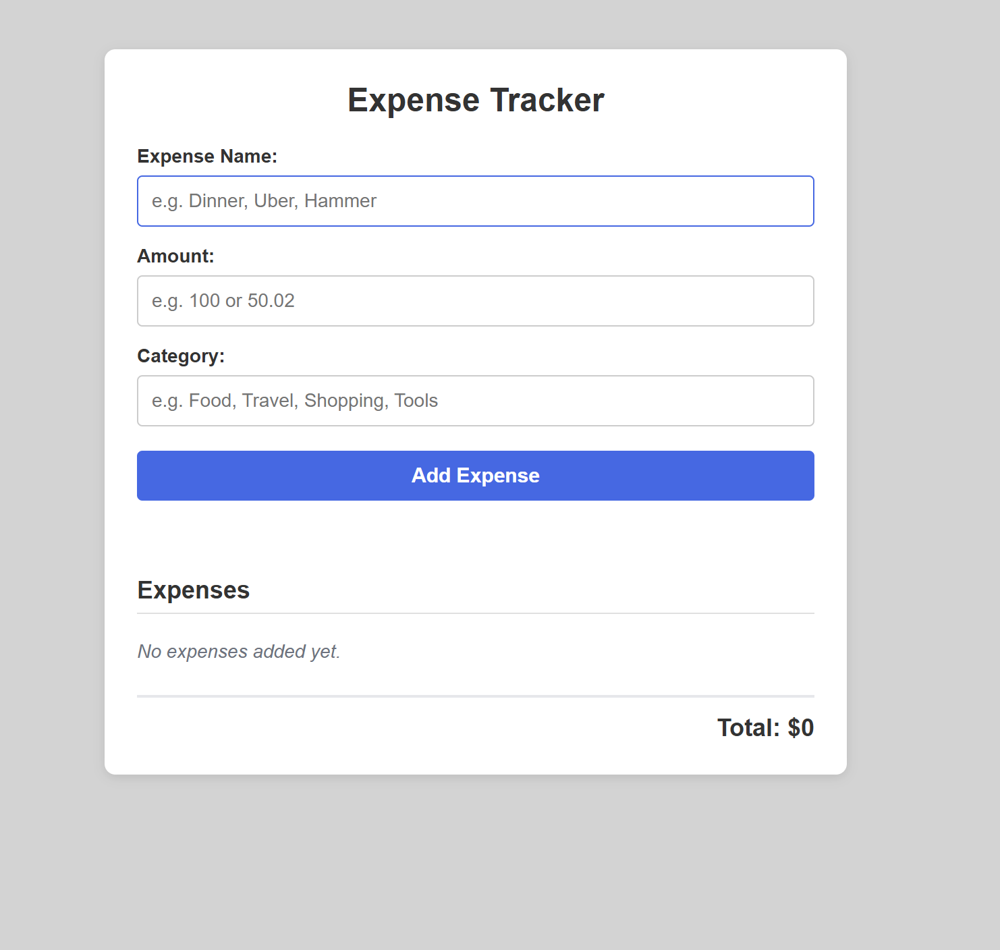
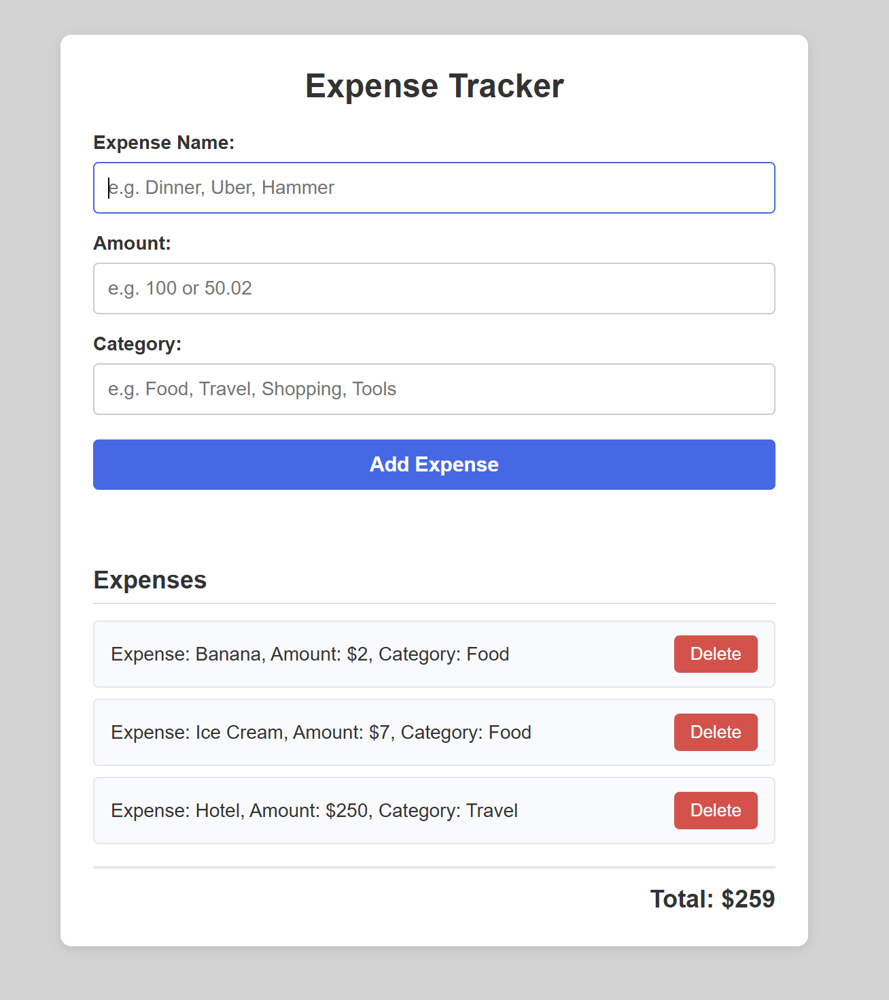
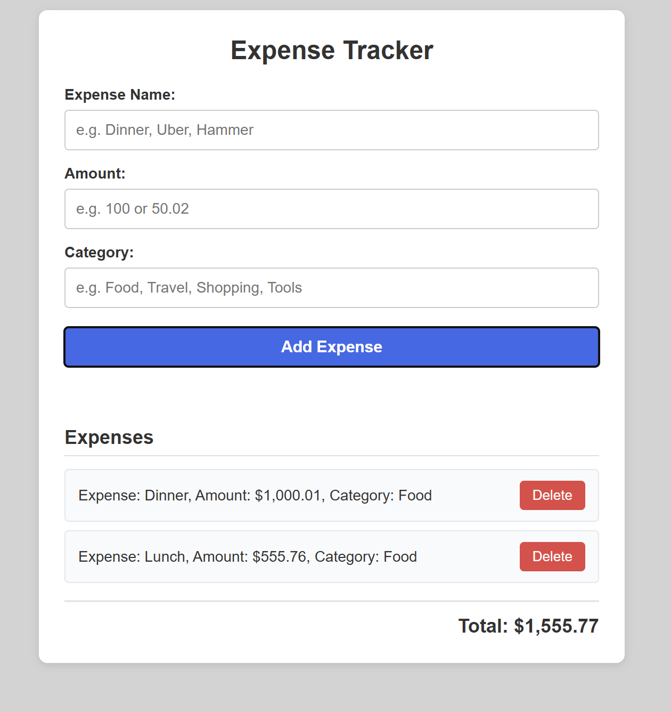
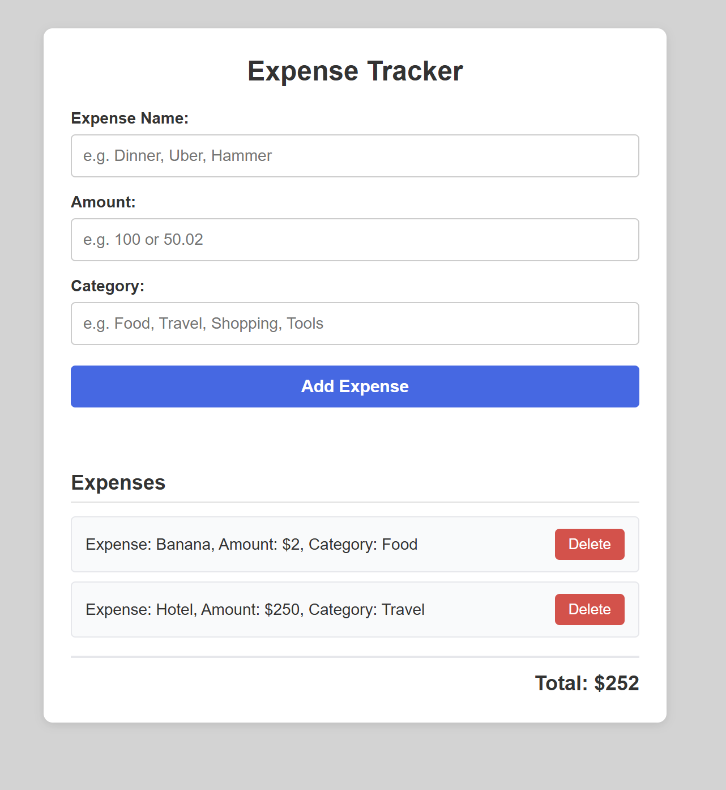
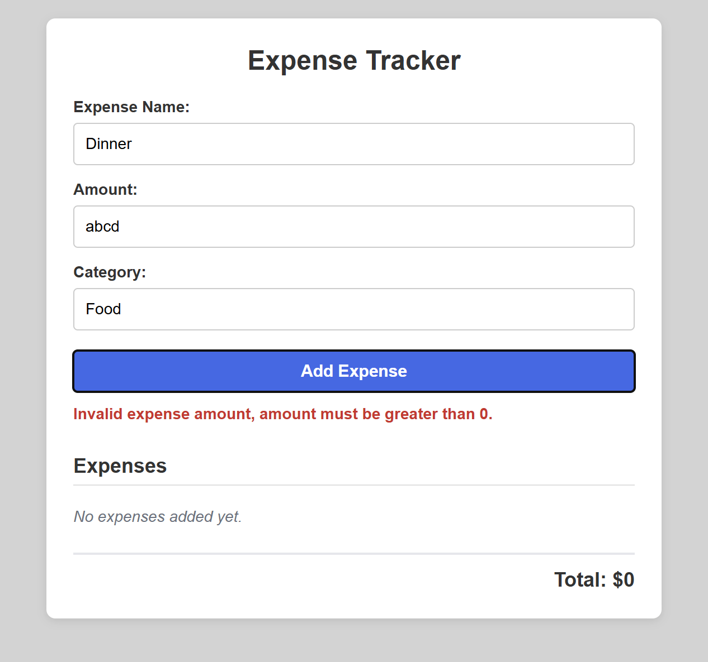
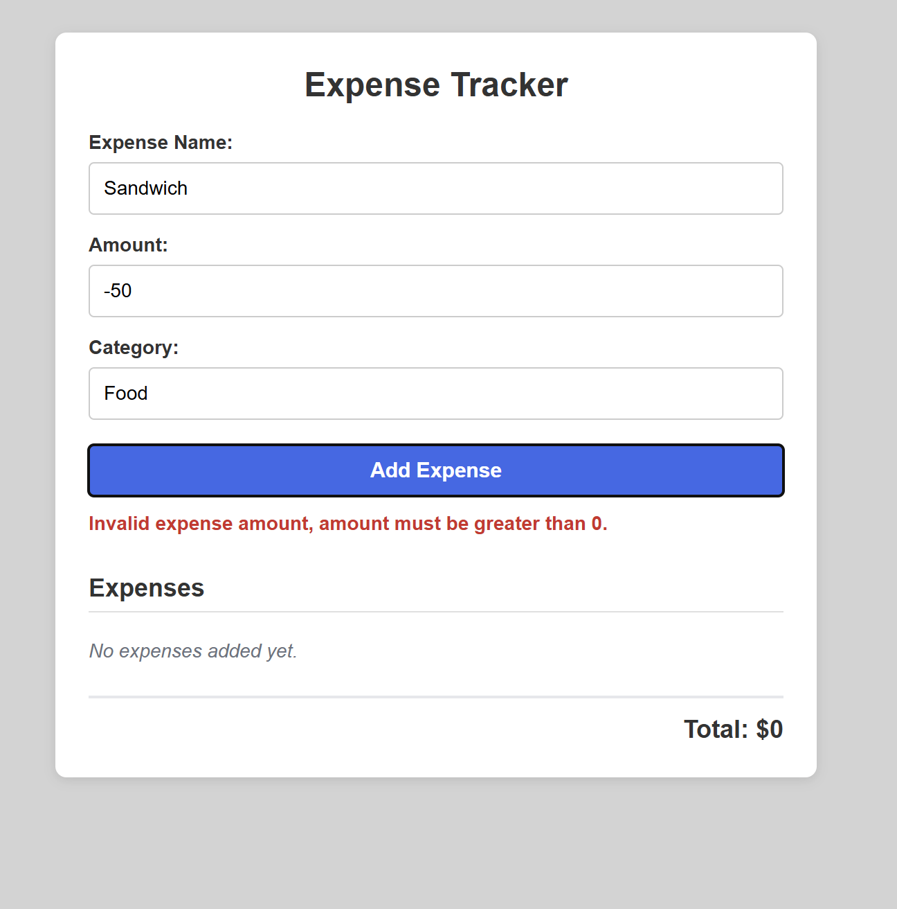
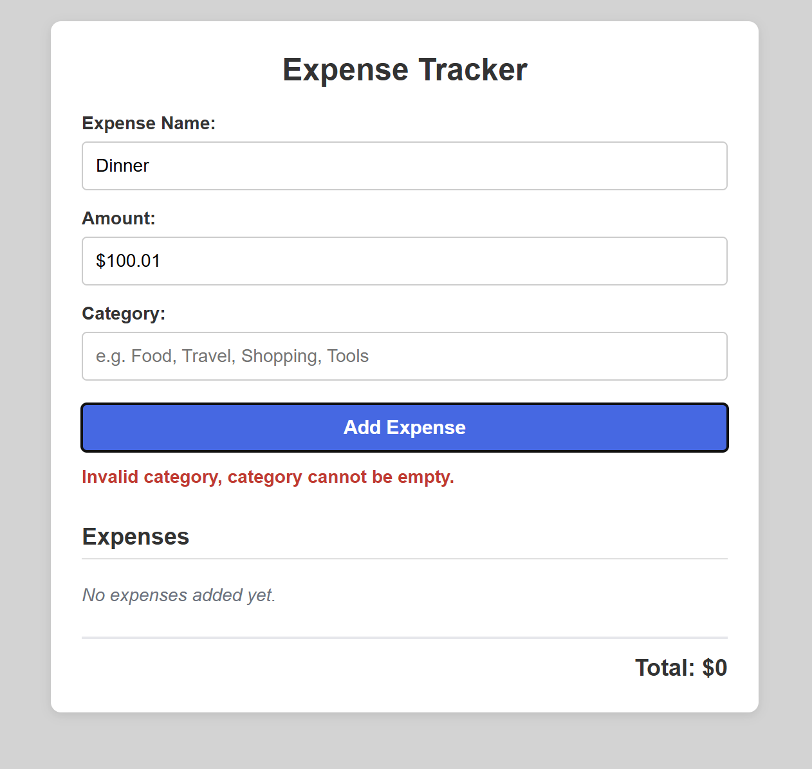
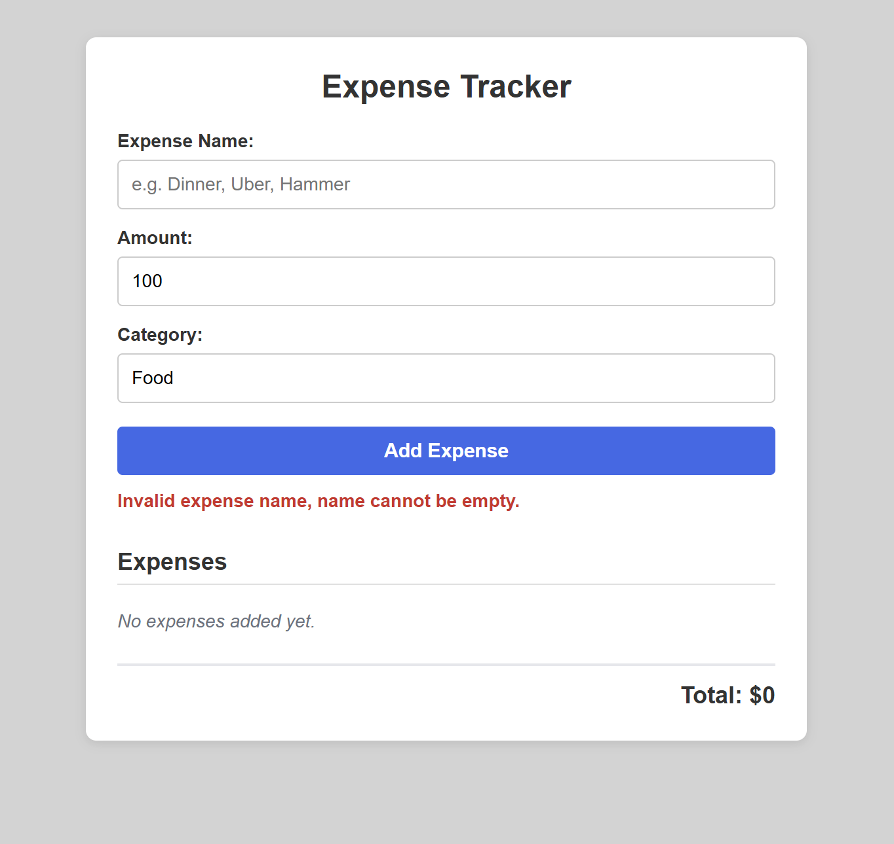

# Smart Expenses Tracker

## Features- Track expenses

- Add expenses (rounded to two decimal places). The input is case insensitive. Users can input dollar sign ($) and commas (,).
- Delete expenses and show that there are no expenses input if there is nothing.
- Track total expe. Display the total with a dollar sign and commas (e.g., $1,001.21).
- Group expenses together that are in the same category
- Error hand for empty/whitespace name and zero/negative/non-number amount.

## Technologies Used

- HTML
- CSS
- Javascript

# How to use

- Open the index.html file in a web browser.

# Screenshots

## Default View

## Valid Input

## Delete Functionality

## Invalid Inputs

### Invalid Amount

### Empty Category

### Empty Expense Name

